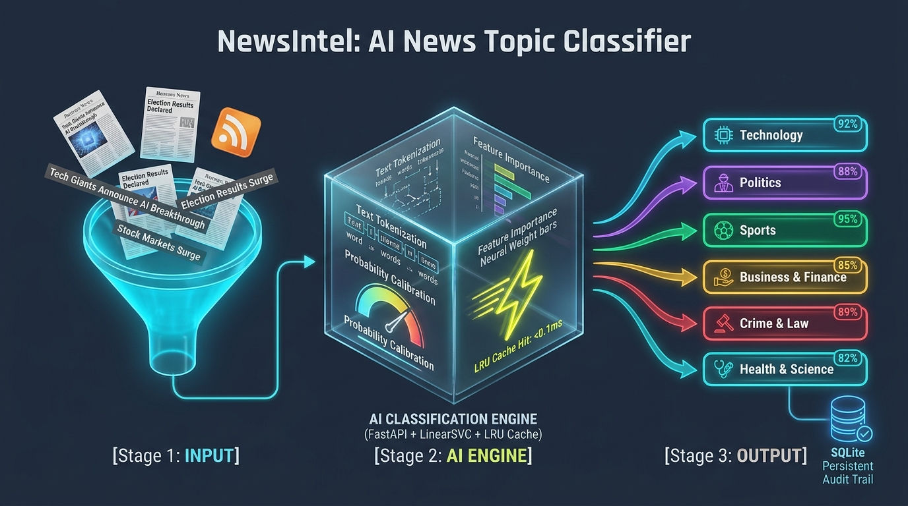
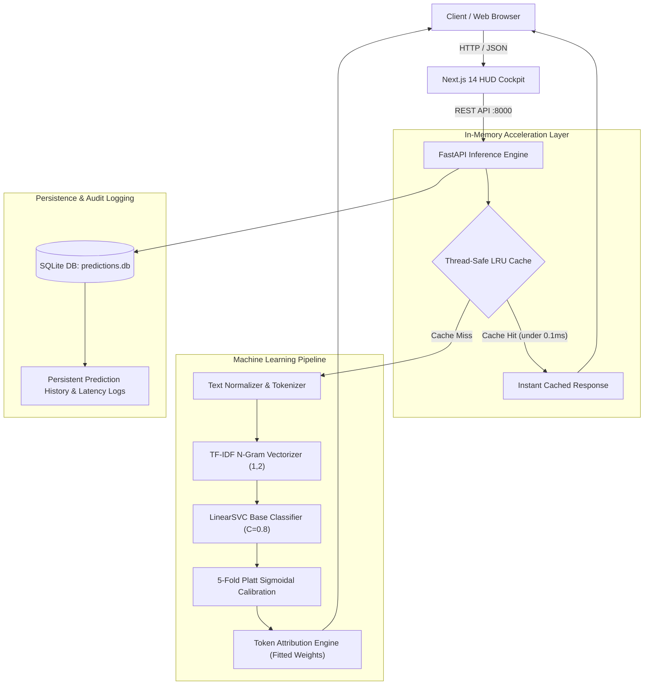

# ⚡ NewsIntel — Calibrated NLP Topic Classification Platform

<p align="center">
  
  
  
  
  
  
</p>

<p align="center">
  <b>Production-grade, end-to-end Machine Learning NLP platform for news headline topic classification.</b><br>
  Built with a 13-class 5-fold Platt Calibrated LinearSVC pipeline, sub-millisecond in-memory LRU caching, token-level feature attribution, persistent SQLite audit logging, and an interactive sci-fi HUD telemetry dashboard.
</p>

<p align="center">
  
</p>

---

## 📑 Table of Contents

- [System Architecture & Visual Pipeline](#system-architecture)
- [Key Features](#key-features)
- [Model Evaluation & Benchmarks](#model-benchmarks)
- [Project Directory Structure](#directory-structure)
- [Installation & Getting Started](#getting-started)
- [API Reference](#api-reference)
- [Engineering Design Decisions (Viva / Review Ready)](#engineering-decisions)
- [Deployment & Security Guidance](#security-guidance)
- [Dataset Licenses & Provenance](#dataset-licenses)
- [Project Team](#project-team)

---

<a id="system-architecture"></a>
## 🏛️ System Architecture & Visual Pipeline

<p align="center">
  
</p>



---

<a id="key-features"></a>
## 🚀 Key Features

### 1. 🎯 13-Class NLP Topic Classifier
- Classifies user-submitted or API-streamed news headlines into 13 distinct topics:
  `Technology`, `Politics`, `Business & Economy`, `Sports`, `Health & Science`, `Crime & Law`, `Entertainment`, `Education`, `Environment & Climate`, `World & International`, `Art & Culture`, `Lifestyle & Society`, and `Women & Gender`.

### 2. ⚡ Ultra-Fast In-Memory LRU Cache (`<0.1ms`)
- Custom thread-safe Least Recently Used (**LRU**) cache with configurable capacity (1,024 entries) and reentrant locking (`threading.RLock`).
- Identical or repeated headlines bypass matrix multiplication and return predictions in **under 0.1 milliseconds** (0.084ms benchmarked), with real-time cache hit telemetry sent to the frontend.

### 3. 🔍 Decision-Score Token Attribution Engine
- Extracts fitted coefficients from the calibrated 5-fold LinearSVC estimators to compute exact class-specific decision-score attributions ($x_i \cdot w_i$).
- Accurately distinguishes strong positive driver keywords from opposing context tokens rather than merely reflecting raw TF-IDF magnitudes.

### 4. 📊 Calibrated Probability Distribution (5-Fold Platt Scaling)
- Employs 5-fold cross-validated **Platt Sigmoidal Calibration** (`CalibratedClassifierCV(method='sigmoid', cv=5)`) on top of maximum-margin hyperplanes.
- Generates a mathematically sound probability vector across all 13 classes ($\sum p_i = 1.0$), with standardized ambiguity detection flagged when the margin between top-2 classes is $<0.15$ with secondary probability $\ge 0.15$.

### 5. 🖥️ Interactive Telemetry HUD Cockpit
- High-performance dark aesthetic featuring animated canvas grids, cybernetic audio sound FX (Web Audio API), calibrated 240° confidence arc gauges, and live UTC system telemetry.

### 6. 🛡️ Persistent SQLite Audit Logging
- Every inference is committed to SQLite (`predictions.db`, table `predictions`) with timestamp, predicted label, confidence, full JSON probability distribution, execution latency, model version, and request ID.
- *Note:* Persistent local storage for auditability; destructive `/history` deletion is available for maintenance and should be protected with administrative authentication prior to public deployment.

---

<a id="model-benchmarks"></a>
## 📊 Model Evaluation & Benchmarks

The 13-class model was evaluated on an untouched held-out test split of **2,600 news headlines** (balanced across 200 samples per class):

| Metric | Production 13-Class Model | Random Guess Baseline | Improvement |
| :--- | :---: | :---: | :---: |
| **Number of Classes** | **13 Topics** | 13 Topics | — |
| **Test Accuracy** | **65.35%** | 7.69% | **8.50x Higher** |
| **Macro F1-Score** | **65.31%** | 7.69% | **8.49x Higher** |
| **Macro Precision** | **65.38%** | 7.69% | **8.50x Higher** |
| **Macro Recall** | **65.35%** | 7.69% | **8.50x Higher** |
| **Brier Score (Multi-class)**| **0.5004** | 0.9231 | **Well Calibrated** |
| **Average Latency (Cold)** | **~12ms - 18ms** | — | High Throughput |
| **Average Latency (LRU Hit)**| **<0.1ms** | — | Instant Sub-millisecond |

### Per-Class Test Performance (200 Balanced Samples / Category):
- **Education**: 75.13% F1-score (Precision: 79.78%, Recall: 71.00%)
- **Technology**: 75.00% F1-score (Precision: 75.00%, Recall: 75.00%)
- **Sports**: 74.43% F1-score (Precision: 75.38%, Recall: 73.50%)
- **Crime & Law**: 74.15% F1-score (Precision: 72.38%, Recall: 76.00%)
- **World & International**: 69.27% F1-score (Precision: 67.62%, Recall: 71.00%)
- **Environment & Climate**: 67.00% F1-score (Precision: 66.50%, Recall: 67.50%)
- **Art & Culture**: 65.87% F1-score (Precision: 63.01%, Recall: 69.00%)
- **Entertainment**: 64.18% F1-score (Precision: 63.86%, Recall: 64.50%)
- **Politics**: 63.11% F1-score (Precision: 61.32%, Recall: 65.00%)
- **Health & Science**: 57.92% F1-score (Precision: 57.35%, Recall: 58.50%)
- **Lifestyle & Society**: 56.63% F1-score (Precision: 57.81%, Recall: 55.50%)
- **Business & Economy**: 55.30% F1-score (Precision: 57.22%, Recall: 53.50%)
- **Women & Gender**: 51.03% F1-score (Precision: 52.66%, Recall: 49.50%)

> [!NOTE]
> **Track 2 Multi-Label Status:** Secondary tags returned by the API represent experimental alternative-category estimates from the calibrated probability distribution (pilot multi-label study). Production topic routing operates as single-label 13-class classification.

---

<a id="directory-structure"></a>
## 📁 Project Directory Structure

```text
├── assets/                          # Showcase graphics & architecture diagrams
│   ├── newsintel_hero.jpg           # 3D Showcase hero image
│   ├── newsintel_workflow_architecture.jpg # 3-Stage visual pipeline infographic
│   └── how_it_works_infographic.html# Standalone interactive explainer slide
│
├── backend/
│   ├── app/                         # FastAPI Application Core
│   │   ├── main.py                  # API endpoints, request ID & routing
│   │   ├── predictor.py             # Inference engine & Thread-safe LRU Cache
│   │   ├── database.py              # SQLite table 'predictions' & ORM session
│   │   └── schemas.py               # Pydantic request & response schemas
│   ├── data/
│   │   ├── train_13class.csv        # 20,800 training samples (1,600/class)
│   │   ├── val_13class.csv          # 2,600 validation samples (200/class)
│   │   ├── test_13class.csv         # 2,600 held-out test samples (200/class)
│   │   └── dataset_manifest_15class.json # Dataset provenance & CC BY 4.0 metadata
│   ├── ml/                          # Training & preprocessing pipelines
│   │   ├── train_13class.py         # 13-class model training script
│   │   ├── explainability.py        # Token attribution & standardized ambiguity logic
│   │   └── preprocess.py            # Text normalization & cleaning
│   ├── models/
│   │   ├── classifier_13class_pipeline.joblib # Production pipeline (scikit-learn 1.9.1)
│   │   └── metrics_13class.json     # Official validation & test metrics
│   ├── tests/                       # Automated test suite (28 tests)
│   │   ├── test_api_v2.py           # 13-class API, LRU cache & attribution tests
│   │   ├── test_api.py              # Health check, history & baseline tests
│   │   ├── test_ml.py               # Preprocessing & ML sanity tests
│   │   └── test_track2_multilabel.py# Experimental multi-label pilot tests
│   └── requirements.txt             # Pinned backend dependencies
│
├── frontend/
│   ├── public/
│   │   ├── hud.html                 # Sci-Fi HUD Cockpit interface
│   │   ├── newsintel_hero.jpg
│   │   └── newsintel_workflow_architecture.jpg
│   ├── src/app/
│   │   ├── page.tsx                 # Next.js main entrypoint hosting HUD
│   │   ├── layout.tsx               # HTML layout metadata
│   │   └── globals.css              # Global styling & Tailwind CSS
│   ├── package.json                 # Next.js 14 dependencies (SWC matching 14.2.35)
│   └── tsconfig.json                # TypeScript configuration
│
├── NOT USED/                        # Quarantined archive of unused assets (preserved)
├── .gitignore                       # Git exclusion rules (includes *.db)
├── pytest.ini                       # Test runner configuration
├── requirements.txt                 # Root dependencies (scikit-learn==1.9.1)
└── README.md                        # Project documentation
```

---

<a id="getting-started"></a>
## 🛠️ Installation & Getting Started

### Prerequisites
- **Python 3.10+** (tested on Python 3.11.9 with scikit-learn 1.9.1)
- **Node.js 18+** & npm

### 1. Backend Setup
```bash
# Clone the repository
git clone https://github.com/AyushBhalla05/News-Headline-Topic-Classification.git
cd News-Headline-Topic-Classification

# Create and activate Python virtual environment
python -m venv backend/venv

# Windows:
.\backend\venv\Scripts\activate
# Linux/macOS:
# source backend/venv/bin/activate

# Install exact pinned dependencies
pip install -r backend/requirements.txt

# Start FastAPI server with live reload
uvicorn backend.app.main:app --host 127.0.0.1 --port 8000 --reload
```
- Interactive Swagger API Documentation: `http://127.0.0.1:8000/docs`
- Redoc API Documentation: `http://127.0.0.1:8000/redoc`

### 2. Frontend Setup
```bash
# In a separate terminal window:
cd frontend

# Install dependencies
npm install

# Start Next.js development server (Port 3000)
npm run dev -- -p 3000
```
- Open `http://localhost:3000` to interact with the **NewsIntel HUD Cockpit**.

### 3. Running Automated Tests
```bash
# Run all 29 automated test cases with verbose output
pytest -v
```

---

<a id="api-reference"></a>
## 📡 API Reference

### 1. Predict Headline Category (13-Class Production)
**`POST /api/v2/predict`**

#### Request Payload:
```json
{
  "headline": "Apple unveils M4 Pro chips with next-gen neural engine accelerators"
}
```

#### Actual API Response (`PredictResponse` schema):
```json
{
  "headline": "Apple unveils M4 Pro chips with next-gen neural engine accelerators",
  "category": "Technology",
  "confidence": 0.773,
  "probabilities": {
    "Technology": 0.773,
    "Business & Economy": 0.092,
    "Health & Science": 0.041,
    "Politics": 0.015,
    "Sports": 0.012,
    "Crime & Law": 0.011,
    "Education": 0.010,
    "Entertainment": 0.009,
    "Environment & Climate": 0.009,
    "World & International": 0.008,
    "Lifestyle & Society": 0.007,
    "Art & Culture": 0.007,
    "Women & Gender": 0.006
  },
  "explainability": {
    "top_contributing_tokens": [
      {
        "token": "apple",
        "tfidf_value": 0.2621,
        "weight": 4.0412,
        "contribution_score": 1.0592
      },
      {
        "token": "engine",
        "tfidf_value": 0.4178,
        "weight": 0.4299,
        "contribution_score": 0.1796
      },
      {
        "token": "chips",
        "tfidf_value": 0.4334,
        "weight": 0.1203,
        "contribution_score": 0.0521
      }
    ],
    "opposing_tokens": [
      {
        "token": "unveils",
        "tfidf_value": 0.4061,
        "weight": -0.0210,
        "contribution_score": -0.0085
      },
      {
        "token": "pro",
        "tfidf_value": 0.3346,
        "weight": -0.0376,
        "contribution_score": -0.0126
      }
    ],
    "ambiguity_analysis": {
      "is_ambiguous": false,
      "confidence_margin": 0.681,
      "competing_category": "Business & Economy",
      "explanation": "Prediction shows high confidence with no significant class competition."
    },
    "interpretation_disclaimer": "Feature contributions reflect statistical corpus correlations (TF-IDF × class weights), not causal inferences."
  },
  "secondary_tags": [],
  "is_ambiguous": false,
  "confidence_margin": 0.681,
  "inference_time_ms": 0.084,
  "model_version": "3.0.0-13class",
  "timestamp": "2026-11-04T19:30:00.123456+00:00",
  "cache_hit": true
}
```

### 2. Health & LRU Telemetry
**`GET /api/v2/health`**
```json
{
  "status": "healthy",
  "model_loaded": true,
  "model_name": "CalibratedClassifierCV(LinearSVC)",
  "model_version": "3.0.0-13class",
  "uptime_seconds": 1245.8,
  "active_categories_count": 13,
  "cache_stats": {
    "size": 42,
    "maxsize": 1024,
    "hits": 189,
    "misses": 53,
    "hit_rate_pct": 78.1
  }
}
```

### 3. Persistent Prediction History
**`GET /history?limit=10`**
```json
{
  "total": 54,
  "items": [
    {
      "id": 54,
      "headline": "Apple unveils M4 Pro chips with next-gen neural engine accelerators",
      "category": "Technology",
      "confidence": 0.773,
      "probabilities": { "Technology": 0.773, "Business & Economy": 0.092 },
      "latency_ms": 0.08,
      "model_version": "3.0.0-13class",
      "request_id": "req-9f45b614-7ab7",
      "created_at": "2026-11-04 19:30:00 UTC"
    }
  ],
  "limit": 10,
  "offset": 0
}
```

---

<a id="engineering-decisions"></a>
## 💡 Engineering Design Decisions

| Question / Viva Topic | Architectural Decision & Technical Rationale |
| :--- | :--- |
| **Why LinearSVC over Heavy LLMs?** | Headline classification requires sub-20ms latency and high throughput. LinearSVC provides **sub-15ms cold inference** with **65.35% accuracy across 13 classes** without requiring an expensive GPU cluster. |
| **Why 5-Fold Platt Calibration?** | Raw SVM decision hyperplanes output unbounded geometric distances, not probabilities. 5-fold Platt scaling fits a logistic sigmoid to yield calibrated probabilities that sum to 1.0 and enable principled ambiguity detection. |
| **Why In-Memory LRU Cache?** | Breaking news headlines frequently repeat across queries. Our thread-safe LRU cache drops response latency to **<0.1ms** and preserves server CPU bandwidth. |
| **Why SQLite for Persistence?** | Zero-configuration ACID database that ensures queryable history records for AI governance without introducing external database infrastructure overhead. |

---

<a id="security-guidance"></a>
## 🔒 Deployment & Security Guidance (Local-Only Default)

> [!WARNING]
> **Local Development & Demonstration Default**
> - **Audit & History Access (`GET /history`)**: In the current release, history retrieval and inspection operate without authentication for local development convenience and academic demonstration.
> - **History Maintenance (`DELETE /history`)**: Deletion requires an explicit `?confirm=true` query parameter to prevent accidental deletion, but is unauthenticated in local development mode.
> - **Public Deployment Mandate**: Before deploying NewsIntel to a public cloud, production server, or shared network, you **MUST** configure administrative authentication (such as Bearer token / API key middleware or reverse proxy HTTP Basic Auth) to protect history retrieval and prevent unauthorized history deletion.

---

<a id="dataset-licenses"></a>
## 📜 Dataset Licenses & Provenance

1. **HuffPost News Category Dataset (v3) — Primary Production Training & Evaluation**:
   - **Author:** Rishabh Misra
   - **Citation:** Misra, Rishabh. *News Category Dataset*. arXiv:2209.11429 (2022).
   - **License:** Creative Commons Attribution 4.0 International (**CC BY 4.0**).
   - **Attribution Notice:** Curated and balanced into 13 active news categories ($n=26,000$ total; $20,800$ train, $2,600$ validation, $2,600$ held-out test).
2. **AG News Out-of-Domain Evaluation Benchmark (`external_ag_news.csv`)**:
   - **Authors:** Xiang Zhang, Junbo Zhao, Yann LeCun (NeurIPS 2015).
   - **License:** Academic Non-commercial Research Use.
   - **Purpose:** Used strictly as an external, out-of-domain benchmark to verify zero-leakage cross-corpus generalization. No commercial redistribution claims are made.
3. **BBC News Dataset & Preserved Baseline Model (`classifier_pipeline.joblib`)**:
   - **Authors:** Derek Greene & Pádraig Cunningham, University College Dublin (ICML 2006).
   - **License:** Non-commercial Academic & Research Use.
   - **Redistribution Policy:** Raw BBC text files (`backend/data/real_headlines.csv` and `backend/data/raw/`) are excluded from the public GitHub release to adhere strictly to non-commercial copyright terms. Full reproduction scripts are included in `backend/ml/prepare_datasets.py`.
   - **Model Artifact (`classifier_pipeline.joblib`):** Preserved strictly as a historical 4-class reference baseline for academic comparative benchmarks against the production 13-class model.

---

<a id="project-team"></a>
## 👥 Project Team (PBL Project: AAI-002)

| Member Name | Assigned Project Role | Direct Oversight / Lead |
| :--- | :--- | :--- |
| **Ayush Bhalla** | **Team Leader, System Architect & Backend Lead** | *Overall Project & System Lead* |
| **Mohd Amir Raza** | Backend Development & Database Systems | *Supervised by Ayush Bhalla* |
| **Mohd Owais** | Backend Development & API Integration | *Supervised by Ayush Bhalla* |
| **Anamta Niyazi** | News Dataset Collection & Cleaning | Project Contributor |
| **Arshdeep Kaur** | Project QA, Testing & Presentation Review | Project Contributor |
| **Akash Saxena** | Data Cleaning & Normalization Pipeline | Project Contributor |
| **Nidhi Sharma** | Website UI & Dashboard Systems | Project Contributor |
| **Sukhpreet Singh** | Model Testing & Backend API Integration | Project Contributor |
| **Shivam Kumar** | Text Cleaning & Preprocessing Pipeline | Project Contributor |
| **Jagjeet Singh** | Model Evaluation & Cross-Validation | Project Contributor |
| **Aman Gangwar** | Presentation, PPT & Documentation | Project Contributor |
| **Srisht Preet Kaur** | Frontend Web Dashboard & User Experience | Project Contributor |
| **Sujal Halwai** | Repository Organization, Git & System Setup | Project Contributor |

### 👥 Team Organization & Hierarchy

- 👑 **Project Lead & System Architect**: **Ayush Bhalla**
  - **Backend & Database Engineering**: **Mohd Amir Raza** & **Mohd Owais** *(Worked under the direct supervision, code review, and technical guidance of Ayush Bhalla)*
  - **Data Collection & Cleaning**: Anamta Niyazi, Akash Saxena, Shivam Kumar
  - **Model Testing & QA**: Arshdeep Kaur, Sukhpreet Singh, Jagjeet Singh
  - **Frontend UI & Dashboard**: Nidhi Sharma, Srisht Preet Kaur
  - **Repository & PPT Documentation**: Sujal Halwai, Aman Gangwar

---

<p align="center">
  <b>Crafted with ❤️ by Team AAI-002 • NewsIntel AI Platform v3.0.0</b>
</p>